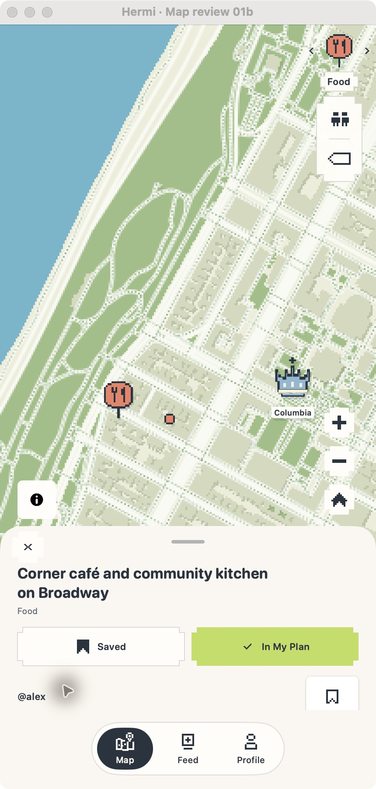

# Increment 3 — Place details and Add review

2026-10-12 · Implemented and desktop-verified; awaiting user review. Native iPhone verification remains pending.

## Open the preview

The native **Hermi Preview** app is open on Map with the long-name café detail sheet. The sheet overlays the map and shows the current place feed. To relaunch from the repository root, quit the preview with Command-Q and run:

```sh
sh apps/ios/HermiPreview/scripts/mac-preview.sh --hermi-pin-review --hermi-place-review=long
```

Wait for the sample map tiles to load. The title is intentionally long to check wrapping; fixture data is local and does not persist.

## What to test and expected results

1. **Title and hierarchy:** confirm “Corner café and community kitchen on Broadway” wraps across lines without clipping or colliding with close/actions. Food remains readable below it. Scroll the sheet to inspect the contextual feed.
2. **Add and Save are separate:** note both initial button states. Click **Add to Plan**: it should become **In My Plan** with a check, while **Save** stays unchanged. Click Save: it should become **Saved**, with Plan membership unchanged. Click again to reverse each action independently. These actions must not create duplicate stops or imply each other.
3. **Return path:** close the place with X. Nearby should reappear with its café result and pin/filter context intact. Reopen the result and confirm the details return. From a map-only detail, X should return to Map.
4. **Short and unavailable content:** check that category and current place context remain understandable when optional address, hours, or review facts are absent. Unknown values must not be presented as confirmed. No failure or live-metadata integration claim is made by this local fixture.
5. **Accessibility:** on a device with VoiceOver, check the wrapped title, category, close control, and independent Save/Add values and labels. Check Dynamic Type and the 44-point action targets on iPhone.

Please report any issue or explicitly approve increment 4. Work will pause here until review.

## Visual evidence



This is an unmodified native macOS desktop screenshot. It is not an iPhone render.

## Verification and limits

- `sh scripts/mac-preview.sh --build-only` passed.
- `DEVELOPER_DIR=/Applications/Xcode.app/Contents/Developer xcrun swift test --disable-sandbox`: 117 tests passed, zero failures.
- `node scripts/test-map-bridge.cjs`: all map bridge checks passed.
- Interactively verified the title, Add-only state update, Save-only state update, and close returning to Nearby with the result preserved.
- Live metadata loading/failure, device gestures, VoiceOver, Dynamic Type on iPhone, and haptics have not been verified.
