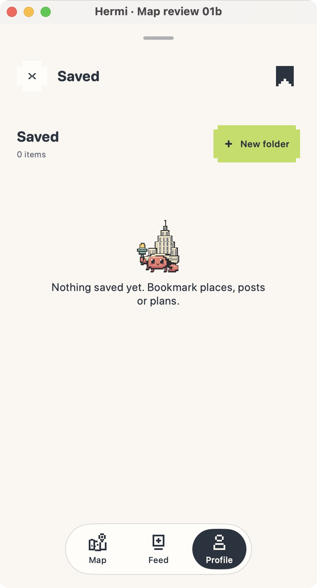

# Increment 5 — Saved review

2026-10-12 · Implemented and desktop-built; awaiting user review. Native iPhone verification remains pending.

## Open the preview

The **Hermi Preview** window is on the Saved screen. To launch the local mixed-content review from the repository root, quit the preview with Command-Q and run:

```sh
sh apps/ios/HermiPreview/scripts/mac-preview.sh --hermi-pin-review --hermi-saved-review --hermi-review-compact
```

The fixture should show saved places, posts, plans and a folder. For empty state, use `--hermi-pin-review --hermi-saved-review=empty --hermi-review-compact`. For long place/folder names, use `--hermi-pin-review --hermi-saved-review=long --hermi-review-compact`. All fixture content is local.

## What to test and expected results

1. **Page hierarchy:** Saved title and item count should read clearly. New folder should be easy to target. Place, post and plan cards should have readable kind, title and useful secondary context.
2. **Long names:** launch the long fixture. Folder/place titles should wrap without truncation or obscuring thumbnails/actions. Increase the window width and check the two-column grid remains balanced.
3. **Folder path:** open “Weekend ideas.” Its long-capable title/count should remain visible alongside Back to Saved. Inspect its place/post/plan content, then return with Back to all saved.
4. **Distinct actions:** open an item to view it; use its context menu for Add, Move, or Remove. Add is explicit and duplicate-safe; opening a card never inserts it. Saved status does not silently add a destination.
5. **Empty states:** launch the empty fixture. The existing crab and a clear bookmark instruction should appear. Create and cancel a folder to check both paths; an empty folder should explain its content state.
6. **Accessibility and privacy:** on iPhone, check VoiceOver labels for item kind/title/secondary context, text scaling, and 44-point New folder/Back targets. Sample content remains labeled as sample; plan visibility remains as saved.

Please report any issue or explicitly approve increment 6. Work pauses here until review.

## Visual evidence



The empty-state composition is shown here. The desktop fixture's saved items were cleared by active preview state during inspection, so the populated mixed-content grid and its folder context actions are ready for your hands-on verification, not claimed as visually verified here. This is a native macOS preview, not an iPhone render.

## Verification and limits

- `sh scripts/mac-preview.sh --build-only` passed.
- `DEVELOPER_DIR=/Applications/Xcode.app/Contents/Developer xcrun swift test --disable-sandbox`: 118 tests passed, zero failures.
- `git diff --check` passed.
- Empty Saved layout rendered. Populated mixed-content layout, folder navigation, context actions, VoiceOver, and native iPhone large text remain pending hands-on review.
