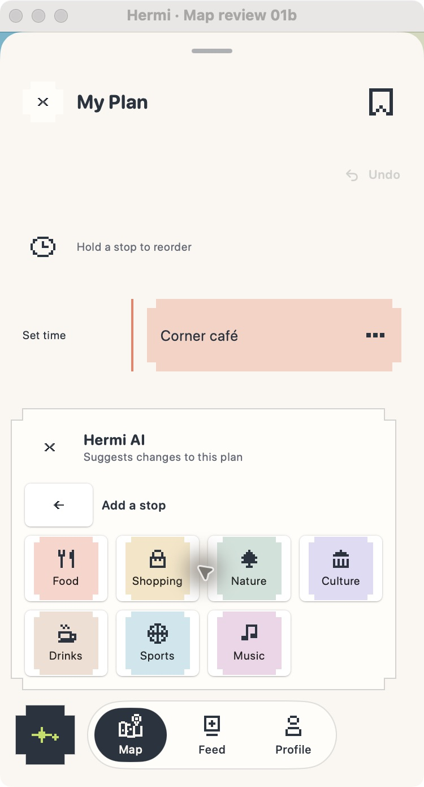

# Increment 6 — Plan Assistant review

2026-10-12 · Implemented and desktop-verified for menu/category layout; awaiting user review. Native iPhone verification remains pending.

## Open the preview

The native **Hermi Preview** window is open to My Plan’s Hermi AI category picker. Use Back to presets to inspect the main menu, or close/reopen with the AI button.

To launch a local recorded-response fixture from the repository root:

```sh
sh apps/ios/HermiPreview/scripts/mac-preview.sh --hermi-plan-review --hermi-ai-review=preview-space --hermi-review-compact
```

Other existing fixture names include `menu`, `category`, `preview-weather`, `preview-activity`, `preview-chat`, `error`, and `menu --content-size=accessibility-extra-extra-extra-large`. Fixture responses are local and do not represent live account data. If a fixture launch opens the regular Map, open My Plan from the top-right Plan control and open Hermi AI from its lower-left button.

## What to test and expected results

1. **Menu size and reading:** from the category picker choose Back to presets. The menu should fit its four choices without the large empty panel seen before; title, purpose, option labels and supporting descriptions should use the existing rounded font and wrap as needed.
2. **Category choices:** choose Add a stop. All seven category choices should remain separate, with readable labels and category colors. On accessibility-size text, the grid should become two columns and scroll within the panel.
3. **Recorded suggestion:** open the `preview-space` fixture. Its explanation, proposed stop/time changes, source links and Apply/Dismiss controls should all be legible. Scroll if needed. Dismiss should discard the suggestion; Apply should be the only action that accepts it. Large text should stack the actions without clipping. The screenshot fixture itself is not a live integration test.
4. **Chat and keyboard:** open Ask about this plan, type a multi-line request, and check the field remains visible with Send available. Scrolling the transcript should dismiss the keyboard interactively. A signed-out request should show a readable connection instruction and retain the draft; a connected test account may receive a server response.
5. **Failure and stale response:** use the `error` fixture to inspect the readable failure and retry path. If changing the plan while a request is pending, its outdated suggestion should be discarded. No suggestion is applied without an explicit Apply.
6. **Accessibility:** use VoiceOver to hear source names and links, category labels, Apply and Dismiss separately, and chat field/send labels. Check actual iPhone Dynamic Type, keyboard avoidance and scrolling at accessibility sizes.

Please report any issue or explicitly approve increment 7. Work pauses here until review.

## Visual evidence



This is an unmodified native macOS desktop screenshot at the ordinary text size. It does not establish iPhone accessibility-size rendering.

## Verification and limits

- `sh scripts/mac-preview.sh --build-only` passed.
- `DEVELOPER_DIR=/Applications/Xcode.app/Contents/Developer xcrun swift test --disable-sandbox`: 118 tests passed, zero failures, including existing provisional/apply/dismiss/error/stale-plan AI state tests.
- `git diff --check` passed.
- Interactively inspected the menu and category picker in the desktop app. The account-dependent response, Apply/Dismiss transaction, chat keyboard and accessibility text scaling remain pending user/device verification.
