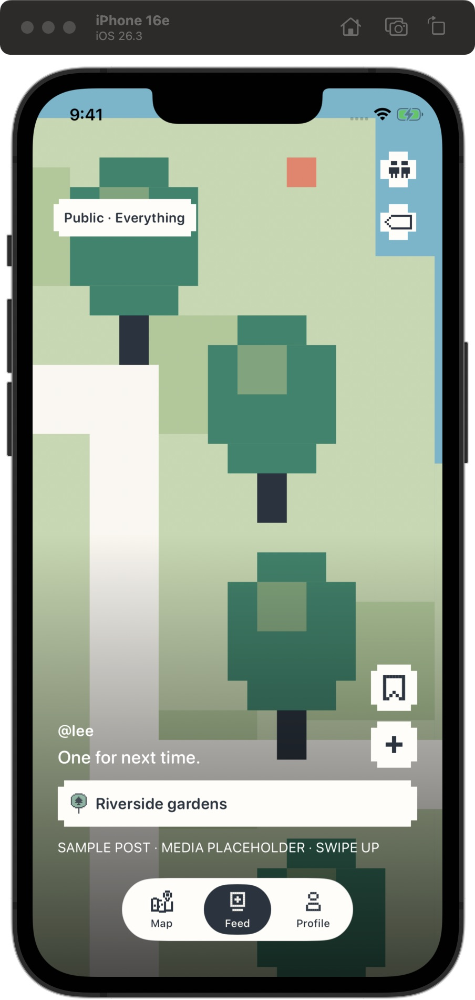
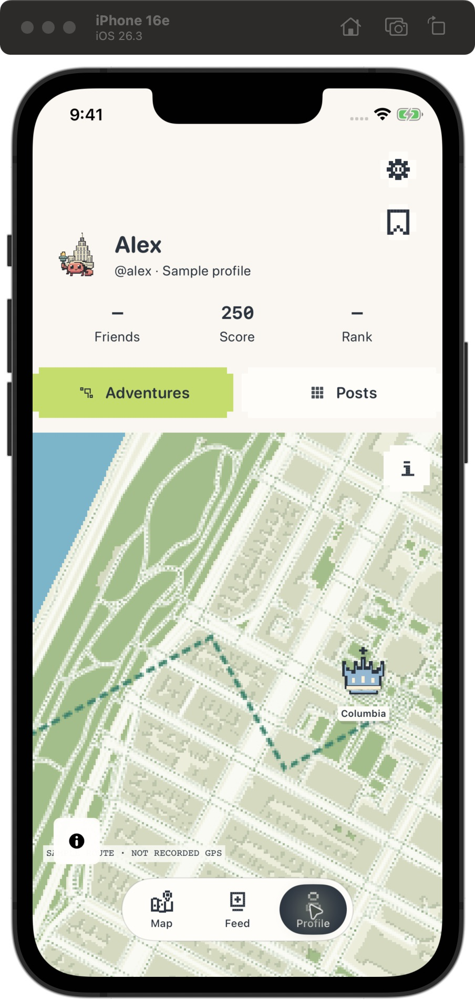
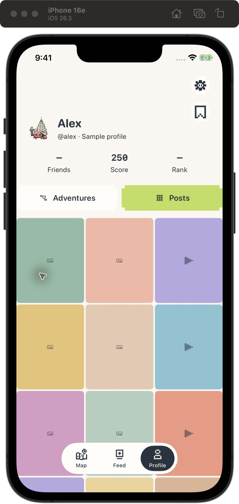

# Increment 7 — Feed and Profile review

2026-10-12 · Implemented and interactively inspected on iPhone 16e simulator (iOS 26.3), default text size. Awaiting user review. No live account data was used.

## Open the preview

The iPhone 16e simulator is open on Profile → Posts and remains interactive. Switch to Feed using the bottom navigation, then return to Profile and try Adventures/Posts.

To launch the local feed fixture:

```sh
HERMI_SIMULATOR_ID=5EED1436-3718-4CF7-8285-29D13112471F sh apps/ios/HermiPreview/scripts/simulator-preview.sh --hermi-feed-review --hermi-feed-long-review
```

This fixture uses only local sample content. It does not sign in, fetch profile/feed data, or use location. For a long caption, choose **Read full caption** to open a scrollable sheet; close it to return to the same Feed page.

## What to test and expected results

1. **Feed reading:** the author and caption should be easy to distinguish, while Save, Add, the place strip and bottom navigation remain visible. Swipe between sample posts and confirm paging still works.
2. **Long caption:** launch the fixture above. The caption should stop at four lines with a **Read full caption** control. Open it, scroll to the end, close it and check that the current Feed page remains selected.
3. **Profile hierarchy:** inspect the name/handle, Friends/Score/Rank and the Adventures/Posts controls. Labels should remain visible alongside their icons. Switch tabs; Adventures should show the profile map, Posts the sample grid, without changing My Plan or Feed state.
4. **Profile content:** open a metric or a sample post and close it. Verify the sheet title and text can wrap and scroll. Sample content remains labeled and should not look like verified activity.
5. **Live account, if configured:** refresh Feed/Profile, inspect a long post and confirm the full-text sheet does not hide Save, Add, Join/Request, or the navigation controls on its page. Failed/empty states should remain readable and retryable.
6. **Accessibility:** check VoiceOver labels for metric controls and selected profile tab, and use accessibility text sizes to review Feed overlays, Profile header and sheets. The simulator is currently at default text size; larger sizes have not been verified.

Please report issues or explicitly approve increment 8. Work pauses here until review.

## Visual evidence







Captures include the Simulator frame. The app viewport is iPhone 16e at default system text size. Feed and Profile use the local sample preview, not live account data.

## Verification and limits

- `sh scripts/mac-preview.sh --build-only` passed.
- `DEVELOPER_DIR=/Applications/Xcode.app/Contents/Developer xcrun swift test --disable-sandbox`: 118 tests passed, zero failures.
- `git diff --check` passed.
- Interactively inspected Feed and both Profile tabs on the iPhone 16e simulator; repeated tab changes left the selected content correct. Metric controls expose separate accessible labels.
- A subsequent simulator rebuild failed when CoreSimulatorService disconnected and Xcode could not write its user-library simulator log/cache. The current app remains open for testing, but the newly added long-caption launch fixture was not loaded. Its code compiles in the macOS preview build; the full-text sheet still needs an interactive check.
- Live account data, accessibility-size text, VoiceOver, and long-caption behavior on a physical iPhone remain pending.
