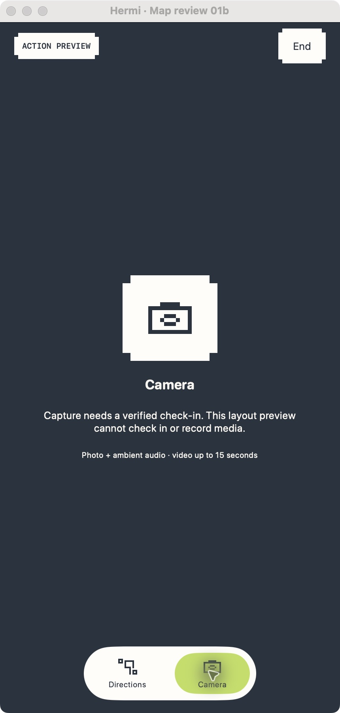
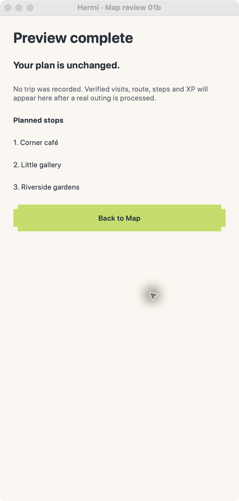

# Increment 8: outing and recap review

The desktop Hermi Preview is open on the local recap screen. It uses the 375 × 667 compact review layout in a macOS window; this is not an iPhone capture.

To reopen it from the repository root:

```sh
sh apps/ios/HermiPreview/scripts/mac-preview.sh --hermi-plan-review --hermi-review-compact
```

Try the local plan review flow:

1. Select **Back to Map**, then **Go** to enter the Action preview.
2. Check Directions and its planned-stop summary. The desktop map renderer can remain on “Loading map…” in this environment.
3. Select **Camera** and confirm the layout clearly says a verified check-in is required and this preview cannot record media.
4. Select **End**, then **Keep exploring**. Confirm the Action preview remains available.
5. Select **End** again and choose **End preview**. Confirm the recap says the plan is unchanged and no trip was recorded.
6. Review all three planned stops and select **Back to Map**.

This review fixture is local-only. It does not call account APIs, access location or camera hardware, record an outing, or change the saved plan. The Live Action SwiftUI view received the same type and wrapping refinements, but remains unverified in a native iPhone run. Native simulator verification is pending because CoreSimulatorService disconnected during the build attempt and Xcode could not write its user-level cache/log. Dynamic Type, VoiceOver, an actual outing/check-in, and device haptics also remain pending.

## Visual evidence

These captures show the Camera and Recap screens from the macOS desktop preview at the compact 375 × 667 logical size:





## Verification

- `sh apps/ios/HermiPreview/scripts/mac-preview.sh --build-only` — passed.
- `swift test --disable-sandbox` — 118 tests passed.
- `git diff --check` — passed.
