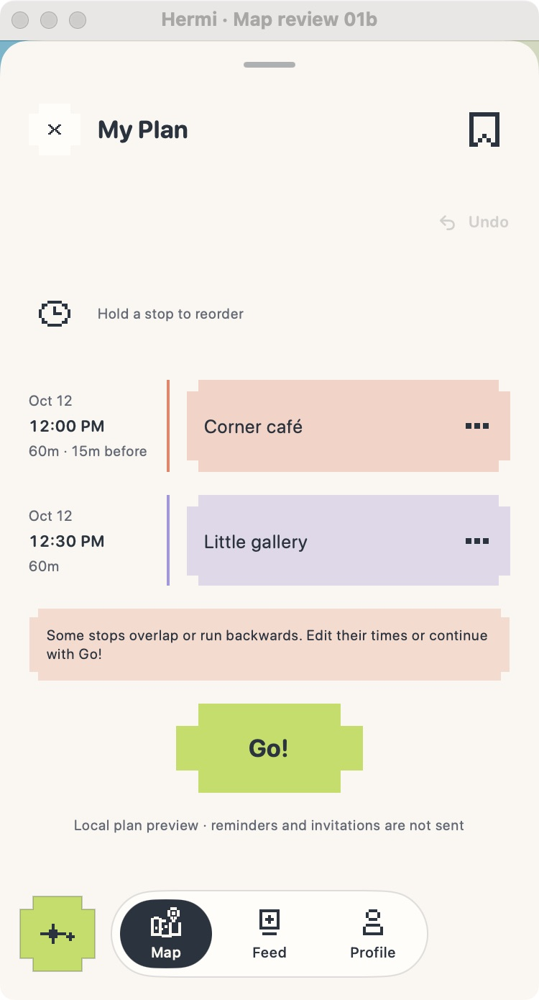

# Increment 9: final visual and journey acceptance

This is the final acceptance checkpoint for the curated UI work. It records the rendered and locally interactive evidence available in this environment, with device and service checks called out as pending rather than inferred from desktop fixtures.

## Preview

The Hermi Preview desktop app is open on the populated My Plan fixture at a compact 375 × 667 logical viewport. It is a macOS preview, not an iPhone build. To reopen:

```sh
cd apps/ios/HermiPreview
sh scripts/mac-preview.sh --hermi-plan-review --hermi-review-compact
```

In the preview, review the two planned stops, the advisory timing warning, the local-only notice and Go action. Go opens the local Action fixture; check Directions, Camera, End confirmation and Recap. The fixtures do not call authenticated services, access location/camera hardware or represent a completed outing. The compact Plan capture is embedded in this review.



## Acceptance record

- **Implemented:** increments 1–8, as recorded in their individual review notes and commits. Existing navigation, plan editing, filtering, assistant suggestion and Action lifecycle semantics were preserved.
- **Rendered and inspected:** baseline desktop captures cover Map, Place, Plan, Saved, Assistant, Feed, Profile, Action and Recap. Later increments include focused captures for map/discovery, Place, Plan, Saved, Assistant, Feed/Profile and Action/Recap. Increment 8’s compact Camera and Recap captures are in `../08-action-recap/`.
- **Interactive desktop checks:** Map category selection leaves Map open and Nearby closed; nearby panel expansion; Plan navigation and warning/Go display; Assistant category suggestion fixture; Feed/Profile tabs; Action mode switch, end-confirmation cancel, local end and Recap; Back to Map.
- **Engineering:** all 118 Swift tests pass. All map bridge scenarios pass, including map, multi-pin, social, route, explored, live-social, landmark and map-chrome contracts. macOS desktop target builds. `git diff --check` passes.
- **Preview/live reconciliation:** shared presentation refinements were applied to both preview and live SwiftUI counterparts where the same surfaces exist. Local preview states do not prove authenticated service or sensor integration.

## Remaining acceptance gaps

- Native iPhone build and interaction across 375 × 667, 390 × 844 and 430 × 932; CoreSimulatorService disconnected during the recent attempt, and Xcode’s user cache/log location was inaccessible.
- Accessibility XXXL/Dynamic Type, VoiceOver order/actions, contrast at every state, and physical-device touch/haptic behavior.
- Real authenticated feed/profile, assistant failure/cancellation against service, location permission denial, offline recording/pending synchronization, verified check-in and camera/upload.
- Desktop Directions can remain on “Loading map…”, so native map rendering and map attribution were not accepted from this environment.
- User review of increment 8’s Action/Recap presentation and this final acceptance record remains the design approval gate.

No unresolved task-blocking defect was found in the surfaces exercised here. The gaps above are environment or live-integration checks and remain open; this checkpoint does not claim complete production or accessibility acceptance.
